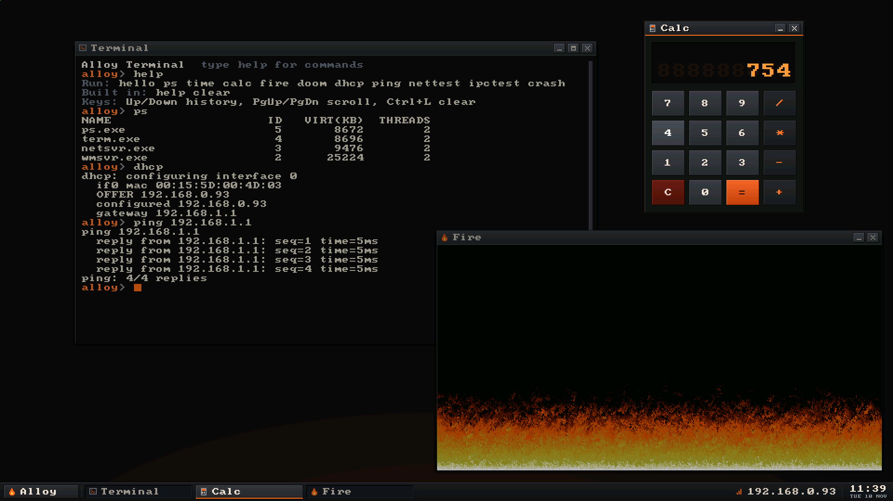
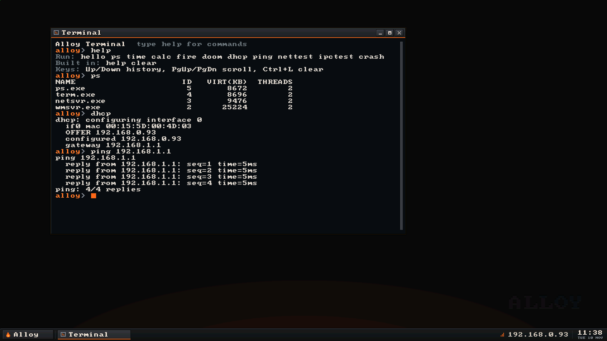
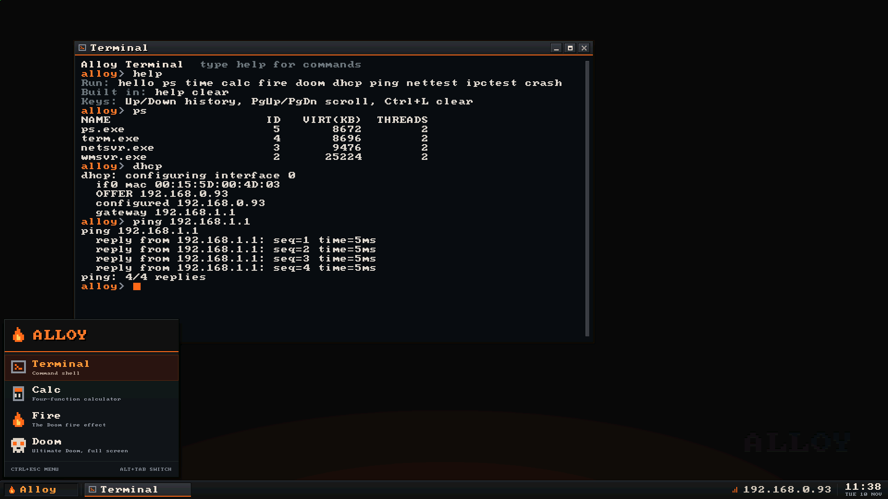
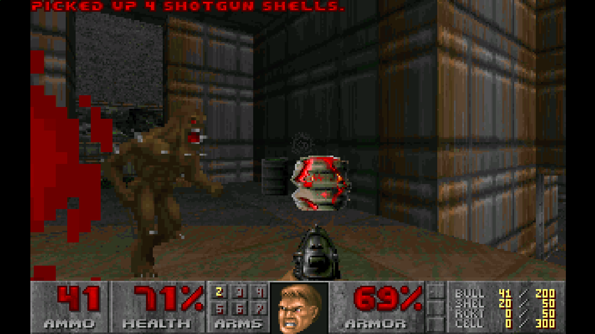

# Alloy

An x64 operating system written in C#, compiled to native code with NativeAOT, running on Hyper-V Gen2. It follows MetalOS's design: a UEFI loader, a higher-half kernel, and ring-3 servers (window manager, network stack) reached through syscalls. The goal is Doom.



## Status

Phases 0 to 8 are done, and Doom is playable. On Hyper-V Gen2, the loader self-tests the CoreLib, maps `kernel.exe` and hands it a `BootInfo`. The kernel then installs its own descriptor tables, page tables and heap, turns on WP/NX/SMEP/SMAP, and runs its self-test on a framebuffer console. A fault produces a symbolized bugcheck. Kernel threads run preemptively on Hyper-V's synthetic timer. The boot disk is read and written through Hyper-V's synthetic SCSI controller: the kernel reads its GPT and mounts the FAT32 Alloy partition as the root, where programs read, write, create, rename, delete and list files. `init` starts ring-3 processes from it that talk to the kernel through syscalls and to each other through ports, events and shared memory. A user-mode window manager ported from MetalOS's (start menu, taskbar, Alt+Tab, framed windows at 1920x1080 over synthvid) composites app windows. `init` starts it, the network stack and a terminal that runs `ps`, `time`, `hello`, `calc`, `fire`, `doom`, `dhcp`, `ping`, `nettest` and `crash`, with their output piped into its window, and has `ls`, `cat`, `write`, `append`, `mkdir`, `rm` and `mv` built in; doomgeneric runs as a ring-3 C program in a fullscreen window. Keyboard, mouse, video, network and the disk are Hyper-V's synthetic devices over VMBus. For Doom, `scripts/build.ps1` copies `DOOM.WAD` from a local Steam install onto the disk when it finds one.

## Screenshots

The terminal running `ps`, `dhcp` and `ping` over the Hyper-V synthetic NIC:



The start menu, taskbar and network status in the window manager:



Ultimate Doom running fullscreen as a ring-3 process:



## Requirements

- Windows with Hyper-V; being in the Hyper-V Administrators group is enough, no elevation
- .NET 10 SDK (see [global.json](global.json))
- Visual Studio 2022 with the C++ x64 tools (for `ml64` and `link`)

## Build and run

```powershell
scripts\build.ps1                                       # images, then build\Alloy.vhdx: an EFI system partition and the Alloy partition
scripts\new_vm.ps1                                      # once: Gen2 VM 'Alloy', COM1 on \\.\pipe\alloy_com1
scripts\boot_test.ps1 -Until 'Alloy Kernel: ready'  # boot, check COM1, power off
dotnet test tests\Alloy.Tests                         # host tests
```

`scripts\read_com1.ps1` dumps raw serial output and `scripts\screenshot.ps1` saves the VM's screen, both useful when a boot hangs before printing a full line. `scripts\send_input.ps1 -Keys Ctrl+Esc,Enter -Click 960,540 -Drag 1200,511,500,200` types, clicks and drags in the running VM.

## Layout

| Path | Contents |
|---|---|
| `src/CoreLib` | The system module compiled into every image: `System.*` types, runtime helpers ILC calls, platform layers |
| `src/Arch/x64` | Privileged CPU instructions (MASM) for the loader and kernel |
| `src/Abi` | Contracts shared between the images, the SDK and host tools: syscalls, boot info, PE and symbol formats |
| `src/Shared` | Device code shared by the loader and kernel |
| `src/Boot` | The UEFI loader, `BOOTX64.EFI` |
| `src/Kernel` | The kernel, `kernel.exe`; `Io` holds the GPT reader, sector cache and FAT32, which the host tests compile too |
| `src/Root` | Files that go at the Alloy partition's root; `build.ps1` adds `bin` and Doom's data |
| `tools/BuildImage` | Builds the VHDX: a FAT32 EFI system partition from `build\esp` and a FAT32 Alloy partition from `build\os` |
| `tests/Alloy.Tests` | Host tests over code shared with the images |
